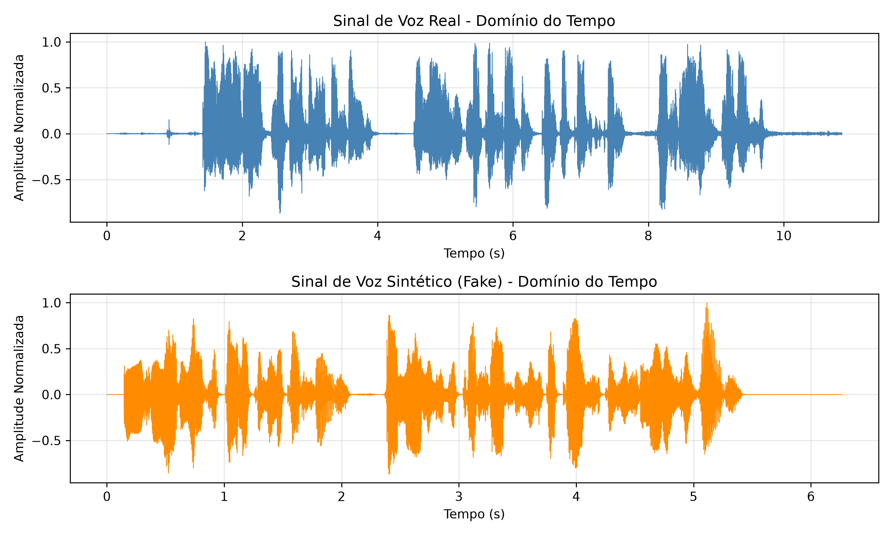
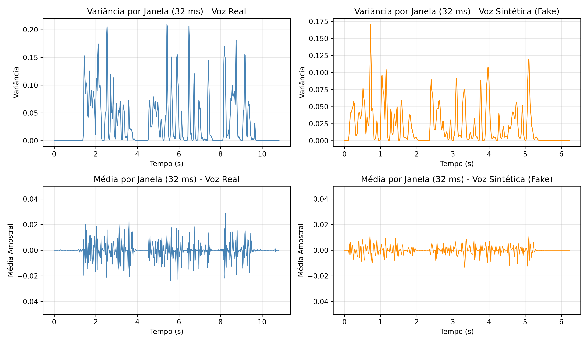
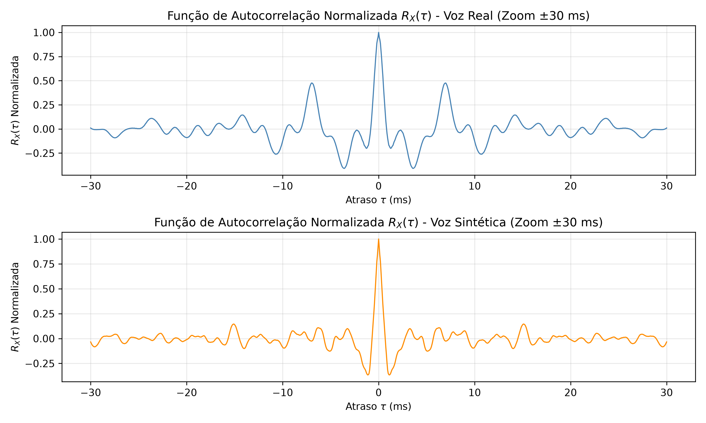
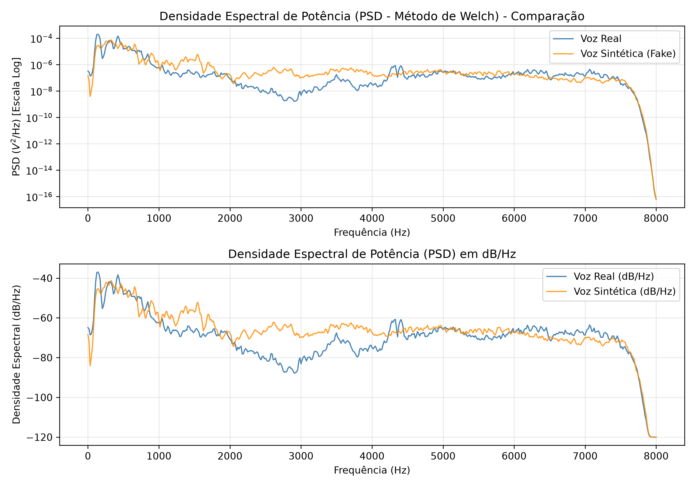

# Análise Estocástica e Espectral de Sinais de Voz: Humano vs. IA (TTS)

Repositório desenvolvido para a disciplina de **Processos Estocásticos para Engenharia** (Engenharia de Telecomunicações - UFSJ / Campus Alto Paraopeba). O objetivo principal é investigar o comportamento estatístico e espectral de sinais de voz, comparando uma gravação humana real com uma locução gerada artificialmente por inteligência artificial (Text-to-Speech - TTS).

---

## 🛠️ Tecnologias e Bibliotecas Utilizadas
O script foi desenvolvido em **Python**, fazendo uso de bibliotecas robustas de processamento de sinais e computação científica:
* `numpy` — Manipulação de arrays e cálculos estatísticos (média e variância).
* `scipy.signal` — Estimação da Densidade Espectral de Potência (PSD) via método de Welch e correlação.
* `librosa` — Carregamento, reamostragem ($16\text{ kHz}$) e conversão de áudio para mono.
* `matplotlib` — Geração de gráficos analíticos em alta resolução ($300\text{ DPI}$).

---

## 📊 Metodologia e Etapas da Análise

1. **Pré-processamento:** Normalização de amplitude no intervalo $[-1, 1]$ e reamostragem padronizada para $f_s = 16\text{ kHz}$ de ambos os áudios.
2. **Estudo da Estacionariedade (WSS):** Divisão dos sinais em janelas curtas de $32\text{ ms}$ ($N = 512$ amostras com $50\%$ de sobreposição) para avaliar a variância e a média local ao longo do tempo.
3. **Função de Autocorrelação ($R_X(\tau)$):** Avaliação da dependência temporal e identificação do período fundamental (*pitch*, $T_0 \approx 7\text{ ms}$) na voz humana em contraste com o amortecimento na voz sintética.
4. **Densidade Espectral de Potência (PSD):** Aplicação do periodograma de Welch (`nperseg=1024`) para mapear a distribuição de energia no domínio da frequência, evidenciando artefatos de vocoders neurais na faixa de $1,2\text{ kHz}$ a $4,2\text{ kHz}$.

---

## 📂 Estrutura de Arquivos
* `analise_estocastica.py`: Script principal contendo toda a pipeline de processamento e plotagem.
* `Trabalho_Processos_Estocasticos_Diego_Rodrigues_2.pdf`: Relatório técnico acadêmico completo com a fundamentação teórica, gráficos gerados e discussão dos resultados.

---

## 🚀 Como Executar o Código

1. Certifique-se de ter o Python instalado junto com as dependências necessárias:
   ```bash
   pip install numpy scipy librosa matplotlib imageio-ffmpeg


   ## 📊 Resultados e Gráficos da Análise

<p align="center">
  
  
</p>
<p align="center">
  
  
</p>
